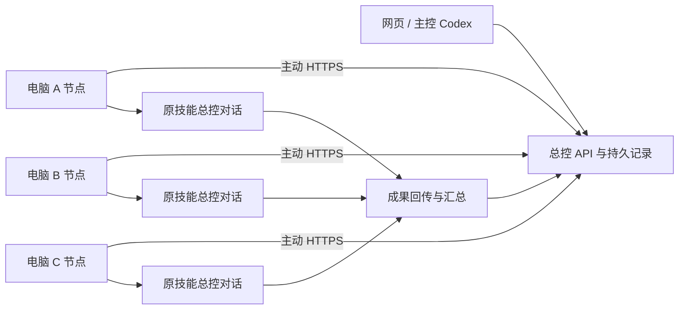

# Codex Fleet：保留本机环境的多电脑协作

把已有 Windows 电脑连接到一个协作台：从网页或主控电脑派发材料和要求，交给目标电脑**已经存在的技能总控对话**执行，完成后回传文件。每台电脑保留自己的 Codex 登录、技能、项目和工具。

这是从实际部署中整理的 0.3.24 源码快照，不包含部署者的站点、令牌、邀请、案件材料、会话数据库和模型凭据。不是 Codex 官方项目，也不是一键保证所有电脑兼容的成品。

## 核心做法

1. **设备身份与模型账号分离**：每台节点独立注册 ID 和凭据。同账号电脑不会被合并成同一个设备。
2. **节点主动连总控**：工作电脑发出 HTTPS 请求，领取任务、上报事件；无需向公网暴露电脑端口。云端总控适合异地网络，旧版本地 Hub 可放在 Tailscale 私网。
3. **复用原总控**：记录 `skill → 主负责设备 → 原 threadId`，按批次传材料和需求；技能总控自己安排制作，Fleet 不再为每件案额外叠加制作、审核、维护链路。
4. **消息与任务区分**：续接传原 threadId，新建才创建新会话。后台执行成功与桌面实际可见分别记录。
5. **文件有交接凭证**：分块传输、偏移续传、SHA256 校验、持久状态；收到文件才算回传完成。
6. **恢复先对账**：重启后保留任务和发件箱；不确定的执行先核对原会话，不盲目新建一份重做。



## 代码地图

| 路径 | 作用 |
|---|---|
| `node/src/worker.mjs` | 节点运行、领取、事件回传、停止与恢复 |
| `node/src/local-store.mjs` | 本地持久任务与传输状态 |
| `node/src/native-continuation.mjs` | 原会话接续 |
| `node/src/desktop-session-bridge.mjs` | 本地桌面共享连接 |
| `node/src/client.mjs` | 交接、上传下载、总控 API 客户端 |
| `node/src/mcp.mjs` | Codex 调用 Fleet 的 MCP 入口 |
| `node/src/hub.mjs` | 旧版可独立运行的本地 Hub |
| `node/scripts/` | Windows 安装、启动、升级、电源及诊断 |
| `console/lib/fleet/skill-owners.mjs` | 技能负责人和原总控绑定 |
| `console/lib/fleet/deliveries.mjs` | 批次派发和成果收集 |
| `console/lib/fleet/handler.mjs` | 网页后端路由 |
| `console/components/fleet/` | 设备、消息、文件、流程与交付界面 |

## 开始使用

先阅读 [部署与验证](docs/DEPLOYMENT.md)，然后阅读 [实现原理与边界](docs/ARCHITECTURE.md)。已有生产安装不要直接用源码目录覆盖。

Node.js 要求 `>=22.13.0`（使用内置 SQLite）。Windows 上安装器另外依赖本机 Codex 与正常登录状态。

```powershell
cd node
node --test test/*.test.mjs
cd ../console
node --test lib/fleet/test/*.test.mjs
```

网站基于 React / vinext / Cloudflare D1 + R2，含 Sites 运行适配代码；普通服务器不能直接把这个 Worker 当作 Node HTTP 服务运行。独立自托管迁移需要配置等价绑定和认证入口，见部署文档。

## 当前边界

- 桌面联动依赖 Codex 版本及本机共享连接状态，**节点在线不等于桌面可控**。
- Windows 应用控制可能拒绝本地启动器。不得关闭安全策略来“修好”；未满足信任要求时保留普通节点能力，桌面能力显示不可用。
- 休眠电脑不能接收普通任务；异地唤醒需要目标局域网的在线中继及硬件支持，不保证所有主机可唤醒。
- 旧版复杂自动流程仍留作兼容，新工作建议使用技能负责人批次交接。不要对正在运行的旧任务强行换合同。
- `console/lib/fleet/delivery-preflight.mjs` 中发布源设备已替换为示例 UUID；部署时必须明确配置本团队发布源，不能把 PC-01 显示名视为授权依据。
- 运行证据与本次源码测试结果见 [VALIDATION.md](docs/VALIDATION.md)。不把内部试跑等同于任意新环境验收。

公开源码用于说明实现和协作方式。此快照尚未授予额外开源许可证；第三方代码保留其原许可，参见 `node/docs/THIRD-PARTY-NOTICES.txt`、`console/build/sites-vite-plugin.LICENSE` 和 `console/vendor/`。
