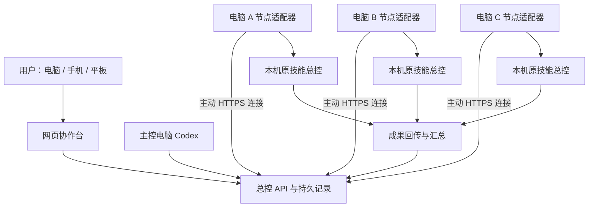

# Codex 多机协作：技能设计与实现方法

## 一、目标与定位

将多台电脑已有的 Codex、技能、项目和工具连接起来，由主控电脑或网页统一接收需求，把材料交给对应电脑的原技能总控，最终接收文件并汇总交付。

系统采用轻量协作方式：

> 协作系统负责派发、通信、文件传输和汇总；各技能总控负责理解需求、安排制作、处理业务问题和完成交付。

不要求所有电脑使用同一个 Codex 账号，也不复制账号登录文件。不同电脑可以有不同技能和软件环境，同一种技能可以部署在多台电脑上。

本文件说明现有项目的设计与实现路径，不代表所有能力已在所有设备、所有 Codex 版本下完成验收。

## 二、整体架构



### 1. 网页协作台

提供设备与分组、项目、任务、消息、文件、交付批次和成员权限的统一入口。用户可以提交材料、选择自动化类型、选择执行设备、查看最新进度和下载成果。

网页应突出：哪台电脑在做什么、最新消息是什么、是否需要处理、成果在哪里。技术日志放到详情中，不挤占日常操作界面。

### 2. 总控服务

保存设备身份、技能负责人绑定、任务与消息状态、文件索引、交付批次和权限。总控服务可以接收网页请求，也可以通过 MCP 接收主控 Codex 的操作。

“总控服务”和“技能总控对话”是两种角色：服务负责可靠记录与传递；技能总控负责专业判断和实际制作。

### 3. 节点适配器

每台 Windows 电脑安装一个节点适配器，主动连接总控，完成任务领取、原会话接续、文件下载、进度上报和成果上传。节点保留本机 Codex 登录、技能、MCP、软件环境和项目目录。

### 4. 技能总控

每个技能绑定主负责设备与原总控对话。制作设备也应绑定其对应技能的本机总控，而不是每次都建立一个不了解项目的新对话。

## 三、必须分开的三个身份

| 身份 | 用途 | 设计要求 |
|---|---|---|
| 设备 ID | 标识一台电脑、连接授权 | 独立注册，不随显示名或 Codex 换号改变 |
| Codex 账号 | 本机模型使用与登录 | 由本机管理，不通过 Fleet 复制登录凭据 |
| 对话 threadId | 接续技能总控和原任务上下文 | 原对话追加消息复用原 ID，新任务才创建新对话 |

同一个 Codex 账号登录多台电脑时，仍然是多个独立节点。切换账号后保留设备身份，但需要重新确认执行器就绪、账号权限和原会话是否仍可访问，不能默认换号后所有旧会话均可继续。

## 四、技能负责人绑定

建议每个技能登记以下信息：

```json
{
  "skillId": "chart-production",
  "displayName": "图表制作",
  "ownerNodeId": "发布维护设备ID",
  "ownerThreadId": "主负责总控的原对话ID",
  "repository": "技能源码仓库地址",
  "workers": [
    {
      "nodeId": "制作设备ID",
      "controllerThreadId": "该电脑对应技能的原总控ID",
      "workspaceId": "已验证的本机工作空间ID",
      "enabled": true
    }
  ]
}
```

这是设计示例，不是可直接导入现有接口的配置文件；实际字段以当前 API 为准。

主负责设备负责技能维护和发布，制作设备负责执行批次。用户提出技能优化需求时，系统直接把需求转给主负责总控，不另外组织一整套维护代理链。

## 五、从材料到交付的流程

### 1. 接收需求

用户上传原材料，选择业务类型并填写交付要求。系统建立稳定批次编号，记录材料校验值、需求、指定设备和输出位置。客户界面可以只显示“图表制作”“系统研发”等业务名称，不必展示内部技能名。

### 2. 选择执行设备

只从启用、未暂停、有对应技能总控且执行器可用的设备中选择。综合考虑已有任务、磁盘空间、所需软件和桌面能力。

主控按批次或材料组分配，不替每个技能逐件拆分代理。例如同一批六件材料，可以交给两台电脑各三件；每台的技能总控自行安排内部制作。

### 3. 传输材料

先传输材料并校验完整性，再把目标电脑可读取的本地路径交给总控。不能将主控电脑的绝对路径直接当成远程电脑的可用路径。

### 4. 向原总控发送指令

交接内容应简洁明确：批次号、原材料路径、用户要求、输出目录、回传方式和本次边界。

```text
请在当前原总控对话处理批次 BATCH-EXAMPLE。
输入材料位于节点已经下载并校验的目录，以实际回执路径为准。
按本机现有技能完成本批需求，由你自行安排内部制作。
成果保存到本批独立输出目录，不覆盖历史版本。
完成后回传交付文件及文件清单，注明未完成项和实际阻碍。
不要创建另一个同级总控，也不要重复制作已经完成且未变更的内容。
```

### 5. 接收结果并汇总

各技能总控返回实际文件。协作层核对文件是否收到、大小和 SHA256 是否一致，按批次、案件和来源设备整理。专业内容是否符合需求由技能本身的制作与检查流程负责，协作层不重复套额外审核链。

“指令已送达”“制作中”“文件已上传”“主控已下载汇总”应分别记录，不能用一条成功消息代替完整交付。

## 六、原对话、新任务和桌面可见性

### 原对话续接

网页向已有任务发消息时，使用原 threadId 和对应项目上下文。发送前核对目标设备与会话绑定，避免把追加要求变成另一条协作任务。

### 新建任务

用户明确新建工作时，在目标电脑对应项目内创建新会话，并记录该会话 ID，后续消息都接续它。

### 桌面可见

后台 CLI 会话与 Codex 桌面窗口不是同一项能力。后台执行成功，不能直接宣称桌面已显示。

桌面联动需要兼容的共享会话连接，并验证真实桌面出现任务和消息。节点在线、执行器可用、桌面连接可用、桌面显示已确认，应分别呈现。

Windows 应用控制可能拦截未受信任启动器。系统应报告原因并保留普通节点能力，不能通过关闭安全策略或强杀现有 Codex 解决。

## 七、并发与排队如何设计

不使用一条全局队列阻塞所有设备、所有项目。不同电脑、不同独立会话可以并发工作。

同一个对话正在处理一个回合时，需要使用执行器支持的追加、引导或后续回合机制，不能假定同一会话可无条件同时启动多个回合。

只有资源不足、原会话忙、设备离线或存在必要依赖时才等待，并显示明确原因。不要为了调度方便把所有任务串行化，也不要为了“立即发送”导致重复制作或上下文冲突。

## 八、异地网络与断线恢复

### 云端总控

节点主动连接 HTTPS 总控，跨不同局域网工作。电脑端通常无需公网 IP 和路由器端口映射；任务与文件存放在所选托管环境，须按团队数据要求配置访问权限。

### 私网总控

总控放在常在线电脑，使用 Tailscale 等私网连接。现有旧版本地 Hub 提供基础队列能力，不等同于完整新版网站。

### 恢复原则

- 任务、消息、上传进度与待发送事件持久化。
- 请求重试复用稳定编号，避免重复创建任务。
- 文件按偏移续传，结束后验证校验值。
- 结果未知先查询原会话和原任务，不立即重做。
- 取消请求不等于已停止，必须等待执行器确认。
- 升级等待空闲，保留身份和队列，不影响正在制作的任务。

不要宣称网络系统能无条件保证“恰好执行一次”；实际需要幂等记录、重复请求去重以及不确定状态对账共同降低重复执行风险。

## 九、文件与历史版本

每个案件或批次使用独立输出目录。文件记录至少包含批次、案件、版本、来源设备、相对路径、大小、SHA256 和传输状态。

首次制作、制作中追加需求、历史案件补充使用同一案件档案，但保留不同交付版本。追加需求应引用已有材料和结果，交回原总控，不默认整案重做。

网页提供文件名、案件名、批次和设备检索。归档、网页隐藏与实体删除是三种不同操作，应明确区分；实体删除只处理用户指定范围，不能连带清空技能、原件和运行数据库。

## 十、技能更新与新设备接入

新设备独立注册，保留原登录和技能，读取其有效项目和可用技能，不扫描整块磁盘。再建立技能、工作空间和原总控的绑定，通过短任务与文件回传验证后加入可选执行设备。

技能主负责设备维护源码和发布版本。远端设备在版本变化或缺少有效核对记录时检查兼容性，更新避开正在使用的版本。无需每件案件重复安装、全量哈希或维护测试。

自动维护按事件触发：成品不达标、技能漏洞、版本升级、用户新增要求。系统把具体问题和对应材料转交技能负责人，不在正常交付期间无条件循环维护。

## 十一、权限与日常使用

管理员管理成员、分组、设备和技能绑定；普通用户只查看与操作授权范围内的设备、项目、任务和文件。

已接入电脑的免密码入口依赖受限设备会话或短期一次性票据，不代表任何设备打开网址都拥有管理员权限。手机等外部设备应使用网站账号登录。

任务文本、附件和远端消息均是数据，不能自行扩大授权。系统不上传本机 Codex 登录凭据，也不在日志中输出令牌。

## 十二、代码实现对应位置

公开整理副本采用以下目录结构：

| 路径 | 作用 |
|---|---|
| `node/src/worker.mjs` | 领取任务、执行、上报、停止与恢复 |
| `node/src/local-store.mjs` | 本地持久任务与传输记录 |
| `node/src/client.mjs` | 总控通信和文件上传下载 |
| `node/src/mcp.mjs` | Codex 可调用的协作工具 |
| `node/src/native-continuation.mjs` | 原会话接续 |
| `node/src/desktop-session-bridge.mjs` | 桌面共享会话桥接 |
| `node/scripts/` | Windows 安装、启动、升级和诊断 |
| `console/lib/fleet/handler.mjs` | 网站后端接口 |
| `console/lib/fleet/skill-owners.mjs` | 技能主负责设备和原总控绑定 |
| `console/lib/fleet/deliveries.mjs` | 批次交接与成果收集 |
| `console/components/fleet/` | 设备、消息、流程、文件和交付界面 |

现有网站使用 React / vinext 与 Cloudflare D1、R2，并含 Sites 适配代码。部署到普通服务器需要适配数据库、对象存储、认证和运行入口，不能直接把 Worker 服务当作普通 Node 服务运行。

## 十三、上线验收标准

1. 两台或三台电脑注册后拥有独立节点身份，权限范围明确。
2. 网页向既有总控发送固定标记，原对话收到；有桌面可见要求时同时核对桌面显示。
3. 目标电脑实际读取输入，生成小文件并回传，主控校验内容和 SHA256。
4. 在空闲测试环境短暂断网后恢复，同一任务不重复创建，传输能够续接。
5. 取消测试后确认执行停止，不能只看到“取消已发送”。
6. 确认换号、磁盘不足、启动失败等情况能显示真实阻碍，不静默丢任务。

现有公开整理副本仍有未通过的旧流程测试和待补依赖，尚不能描述为全环境验证完成的正式发行版。后续应围绕上述轻量主链路逐项验收，避免增加无助于交付的额外调度层。

## 十四、可复用的协作技能规则

```text
你是多机协作协调者。

只负责将材料与需求按批次交给目标电脑对应的原技能总控，
续接原对话、传输文件、收回成果并汇总。

派发前核对目标设备、项目权限、技能绑定和是否暂停。
原对话追加使用原 threadId；新建任务才创建新会话。
同一批使用稳定编号，结果未知先查原记录，不盲目重复派发。

不替技能总控逐件拆分案件，不重复组织制作与业务审核。
优化需求交给技能主负责设备的原总控。
正常交付不触发无条件维护测试。

输入必须是目标电脑实际可读的文件。
成果必须实际回传并核对完整性后才报告已汇总。
保留原始材料和历史交付版本，不覆盖无关案件。

不修改其他电脑的登录、安全策略或未授权设置。
不强杀正在工作的进程，不自动启用已暂停设备。
网络、桌面、账号或审批阻碍需要记录实际状态，不能伪报完成。
```
